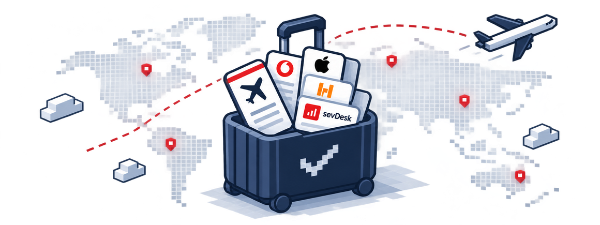
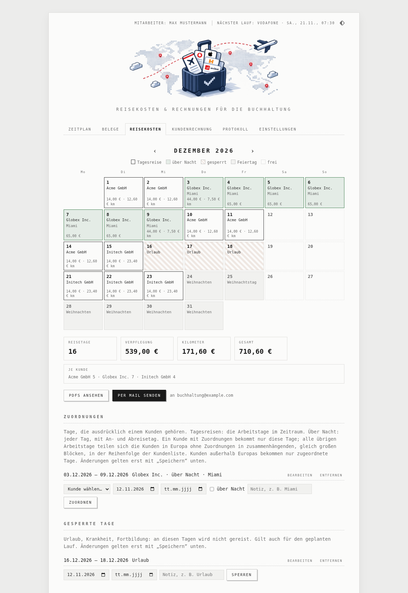
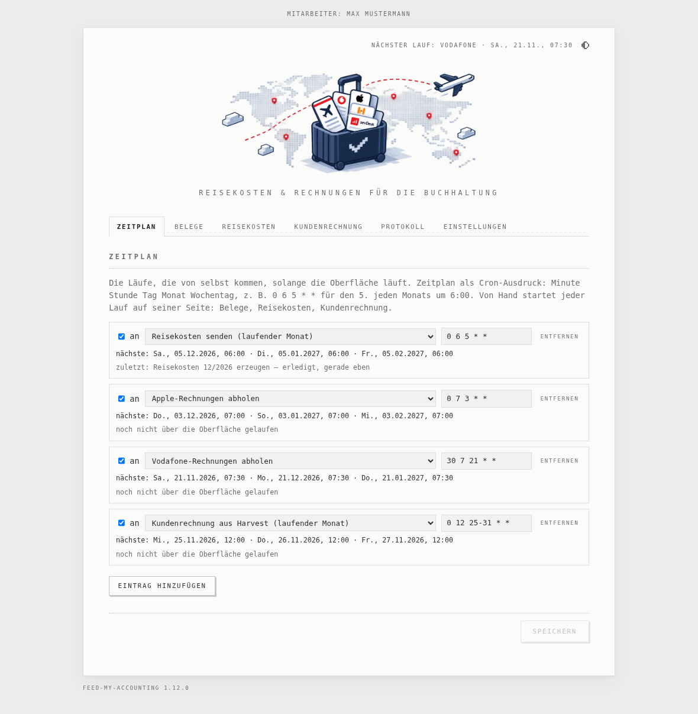
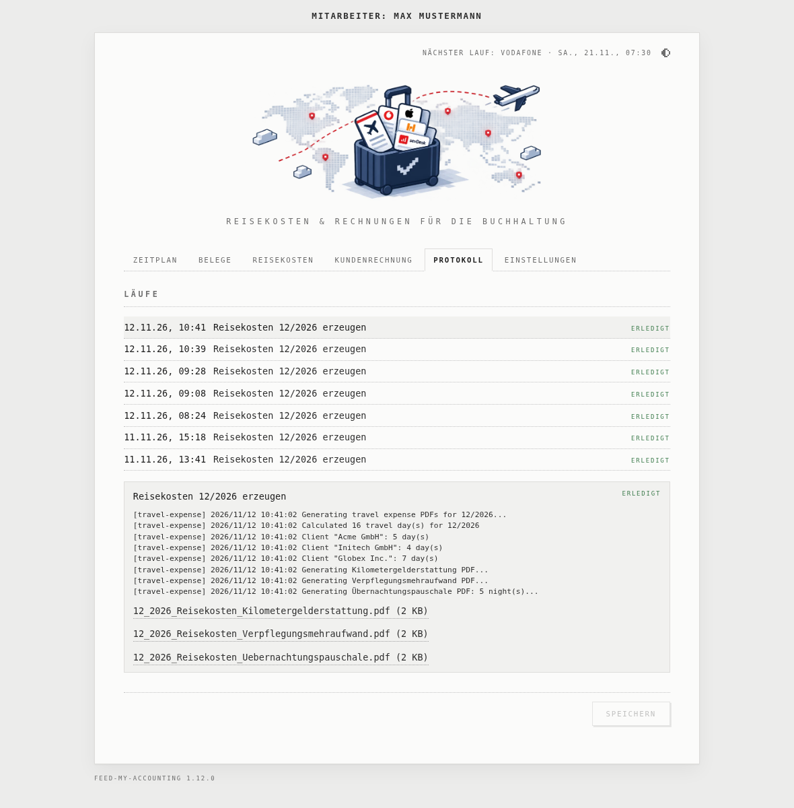
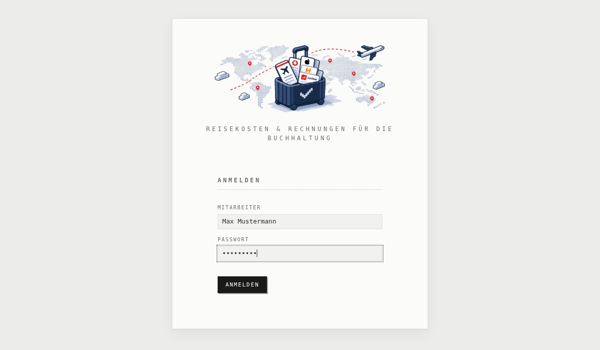
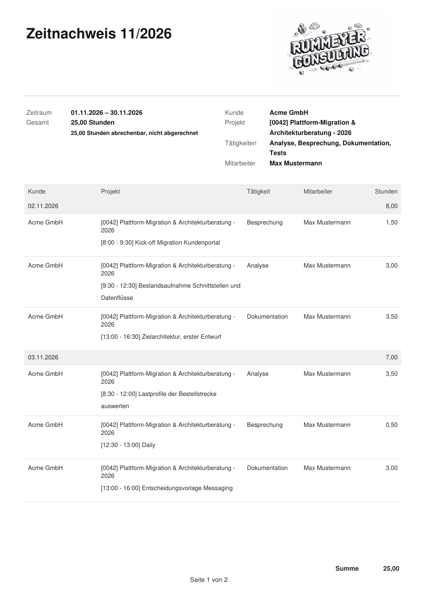

# feed-my-accounting

<p align="center">
  
</p>

[](CHANGELOG.md)
[](LICENSE)

A single command that closes your books for the month.

Every month, freelancers and small businesses juggle the same ritual: collect invoices from Anthropic, Apple and Vodafone, generate travel expense reports, turn Harvest timesheets into outgoing invoices, and feed everything into the accounting system. **feed-my-accounting** automates all of it — from source to [sevDesk](https://sevdesk.de).

It connects its sources — mailboxes, MeinVodafone, the Harvest API and your calendar — to your sevDesk account, each handled by a dedicated module:

| Module | Source | What it does | Delivery |
|--------|--------|-------------|----------|
| **travel-expense** | Config (clients, distances) | Generates Kilometergelderstattung, Verpflegungsmehraufwand and Übernachtungspauschale PDFs | Email → sevDesk Autobox |
| **anthropic-invoice** | IMAP inbox and *Rechnungen* | Fetches Anthropic's receipt emails and takes the receipt PDF each brings | Email → sevDesk Autobox |
| **apple-invoice** | IMAP inbox and *Rechnungen* | Fetches Apple invoice emails, converts HTML to PDF via headless Chrome | Email → sevDesk Autobox |
| **vodafone-invoice** | MeinVodafone portal | Logs in via headless Chrome, downloads Mobilfunk + Kabel invoices | Email → sevDesk Autobox |
| **harvest-invoice** | Harvest API | Reads the month's hours of a client from the Harvest API, makes the work log PDF, creates the draft invoice in sevDesk | Direct browser automation |

### How it all fits together

<p align="center"></p>

Four modules — anthropic, apple, vodafone and travel-expense — collect documents and deliver them as email attachments to sevDesk's **Autobox** — an inbox that automatically imports and OCR-parses incoming PDFs as bookkeeping records. The fifth (harvest-invoice) goes further: it logs into sevDesk directly and creates a fully populated draft invoice, ready for review.

Run once a month with a single command — or schedule it with cron — and your accounting is fed.

All modules share a single `config.yaml` with a common `mail` block for SMTP/IMAP credentials and addresses.

Run them from the command line or cron as before — or start the **web interface** (`feed-my-accounting serve`): a register card per area of work, a month calendar for the travel expenses with vacation and client assignments, Harvest PDF upload for the sevDesk draft, a built-in **schedule** that replaces crontab, a live log of every run, and the settings. See [Web interface](#web-interface).

## Requirements

- Go 1.25+
- Google Chrome or Chromium (required by `apple-invoice`, `vodafone-invoice`, and `harvest-invoice`)

## Installation

```bash
go build -o feed-my-accounting .
```

## Usage

```bash
feed-my-accounting [--config path] [command] [args...]

# Run all modules for the current month (default when no command is given)
feed-my-accounting
feed-my-accounting all

# Run all modules for a specific month
feed-my-accounting all 3/2026

# Travel expense report for current month
feed-my-accounting travel-expense

# Travel expense report for a specific month
feed-my-accounting travel-expense 3/2026
feed-my-accounting travel-expense 12/2025

# Apple invoice emails → PDF → email
feed-my-accounting anthropic-invoice
feed-my-accounting apple-invoice

# Vodafone invoices → email
feed-my-accounting vodafone-invoice

# Harvest → sevDesk draft invoice (current month, or the one given)
feed-my-accounting harvest-invoice
feed-my-accounting harvest-invoice 10/2026

# Web interface with schedule (web.listen, default :8595)
feed-my-accounting serve

# Custom config file
feed-my-accounting --config /path/to/config.yaml all 3/2026

# Show version
feed-my-accounting --version
```

## Web interface

```bash
feed-my-accounting serve          # http://<host>:8595
```

<p align="center">
  
</p>

<p align="center">
  
  
</p>

<p align="center"><sub>Screenshots with made-up customers, people and data — the company, its name and logo, is the author's. The page speaks German or English — the browser's language at first, then *DE | EN* at the top right; the PDFs and mails stay German, for the German books. Dark mode follows the system, or the switch beside it — sun, moon, half disc, as on rummeyer.com: <a href="docs/travel-dark.png">Reisekosten in dark</a>, <a href="docs/invoice.png">Kundenrechnung</a>, <a href="docs/settings.png">Kunden</a>, <a href="docs/company.png">Firma und Mitarbeiter</a>, <a href="docs/worklog.png">a Zeitnachweis</a>, <a href="docs/login.png">the login</a>.</sub></p>

`serve` starts a small web server — one Go binary, the page embedded — with a register card per area of work. Everything it does is also what the command line does; it reads `config.yaml` afresh on every request, so edits by hand count at once.

Every setting is on the card where it is used. Nothing saves by itself: one red *Speichern* at the bottom of the page saves every change on every card — settings, schedule, Zuordnungen, gesperrte Tage — and says beside it what is not saved yet. The first click turns it into *Sicher?*, the second within four seconds saves. *Abbrechen* beside it drops what is not saved yet, everything as saved again.

| Card | What it does |
|------|--------------|
| **Zeitplan** | The schedule: each job with its cron expression (`minute hour day month weekday`, as in crontab, with Quartz's forms for days — see below), and beneath it in one line when it last ran — *manuell* or *zeitgesteuert*, the same day as *vor 2 h* — and its next runs, as many as fit; and a switch to turn it off. Runs by hand start on their own cards. Replaces the crontab entries — keep only one of the two, or jobs run twice. |
| **Reisekosten** | A month calendar: which client gets which day, day trips and overnight trips, holidays, blocked days, and each day's meal allowance and mileage, with the month's totals. *Zuordnungen* gives date ranges to a client explicitly; *Gesperrte Tage* blocks vacation and the like. Both are edited as drafts — add, *bearbeiten*, *entfernen* — and saved with the *Speichern* at the bottom; until then nothing changes. *PDFs ansehen* generates the two PDFs to look at; *Per Mail senden* sends them to the address under Einstellungen › E-Mail. Below: the clients — country, state, distance, meal rates — the name on the PDFs and the Christmas week. |
| **Belege** | Anthropic, Apple and Vodafone invoices on demand, each with its settings: the Anthropic and Apple mail filters, the Vodafone login. Each with *PDFs ansehen*, fetching them for download, and *Per Mail senden*, sending them too, after asking: Anthropic and Apple by month — `11/2026`, the current one at first — Vodafone the current month's. The schedule sends the current month's. |
| **Kundenrechnung** | *Aus Harvest anlegen* runs harvest-invoice for the month given next to it as on the command line (`11/2026`): the hours come from the Harvest API, and the month's work log PDF comes with the run for download — on iCloud Drive, say. *Nur Zeitnachweis* makes only the work log. Fewer hours than the client's days × 8 log a warning with the link to the time entries in Harvest: the days the Reisekosten give the travel client of the sevDesk client's name — with another client's week away in the month, only the rest — and without such a client every workday, as the Reisekosten count them. A project of the work log over its budget in Harvest — hours or money, as Harvest's project budget report has it — logs a warning too, with the link to the project; a monthly budget only for the current month, Harvest reporting only its spending. As a fallback, behind its own flap at the foot of the card, *Zeitnachweis hochladen*: drop a Harvest PDF report in hours and Leistungszeitraum are read and shown for checking, then *Entwurf in sevDesk anlegen* creates the draft invoice — with the same duplicate check. Folded away beneath the buttons, *Einstellungen Kundenrechnung*: the sevDesk client, article and reference, the sevDesk login, the Harvest API token and the client's name in Harvest. |
| **Protokoll** | The last 50 runs; a click opens a run's output under it, with the PDFs it made to download. The history is kept in `feed-my-accounting-jobs.json` next to the config; the PDFs until the server restarts, then listed by name only. Web addresses in the output are links. *Löschen* at the bottom, after *Sicher?*, empties it. |
| **Einstellungen** | What all of them share: the **company** — its name, and its logo (PNG or JPEG, kept beside the configuration as `feed-my-accounting-logo.png`), which the work log shows instead of the name — the **employees** — the one ticked is the Lieferant on the travel expenses and whose hours in Harvest make the work log and the invoice, named as in Harvest; shown at the top right as *Mitarbeiter* — the mail account, and the web interface's address and password. |

Passwords are never sent to the page: leave a password field empty to keep it. A field left empty shows its default as a hint.

**Saving from the web interface rewrites `config.yaml`** — values intact, comments gone — and keeps the previous file as `config.yaml.bak`.

One job runs at a time; a scheduled job due while another runs is tried again every minute for half an hour.

### Running it as a service

[`feed-my-accounting.service`](feed-my-accounting.service) runs the web interface and its schedule at boot. Set `User`, `WorkingDirectory` and the paths to yours, then:

```bash
sudo cp feed-my-accounting.service /etc/systemd/system/
sudo systemctl enable --now feed-my-accounting
journalctl -u feed-my-accounting -f
```

### Cron expressions

Five fields, `minute hour day month weekday`, as in crontab — `*`, numbers, ranges `1-5`, lists `1,15` and steps `*/15` — a day matching when its day of month or its weekday does, both being restricted. Beyond that, what Quartz has for days:

| Form | Field | Means | Example |
|------|-------|-------|---------|
| `L` | day | the month's last day | `0 7 L * *` — the 30th, 31st, 28th… at 7:00 |
| `L-n` | day | n days before it | `0 7 L-2 * *` |
| `nW` | day | the workday nearest the nth, within the month | `0 7 15W * *` |
| `LW` | day | the month's last workday | `0 7 LW * *` |

A workday for `W` and `LW` is one as the Reisekosten count it: Monday to Friday, no public holiday — Germany's, in the state of the first German client — no blocked day, and not in the Christmas week if that is off. With the 31st of December blocked, `LW` in December 2026 is the 30th.
| `nL` | weekday | the month's last such weekday | `0 7 * * 5L` — the last Friday |
| `n#k` | weekday | the kth such weekday | `0 7 * * 1#2` — the second Monday |
| `JAN`–`DEC`, `SUN`–`SAT` | month, weekday | names for the numbers | `0 7 * * MON-FRI` |
| `?` | day, weekday | the same as `*` | |
| `@yearly`, `@monthly`, `@weekly`, `@daily`, `@hourly` | — | shorthands, at midnight | `@monthly` |

New entries start at `0 7 1 * *`, the 1st at 7:00.

### Who may reach it

The page holds the keys to your mail, Vodafone, Harvest and sevDesk accounts, so by default it answers **the home network only** (`web.homeOnly`, on the web interface *Nur im Heimnetz erreichbar*): private addresses (`10.…`, `192.168.…`), localhost and local IPv6 — not `172.16–31.…`, where Docker puts its containers: one of them, open to the internet, is not at home. Anything else gets *403*, even if the port is open to the internet by mistake. A VPN such as Tailscale uses addresses outside the private ranges (`100.64.…`) and is not let in.

### Logging in

Every employee can have a **password** (Einstellungen › Mitarbeiter, at least 8 characters, kept only as a bcrypt hash in `staff.logins`). As soon as one has, every page and call needs a session:

- **At home**, the login page asks only for the employee — a dropdown and *Anmelden*, no password. A password lost is set anew from there; no reset by mail is needed.
- **From outside** — `web.homeOnly` switched off, through a reverse proxy with HTTPS — it asks for the employee's name, typed — no list of employees shows — and their password.

<p align="center"></p>

As long as no employee has a password, the page answers the home network only, whatever `web.homeOnly` says. A session ends after 24 hours without a request — the page's own polling does not count, so an open tab logs out too and shows the login — and each request renews it; it is in a cookie the page's scripts cannot read, sent over HTTPS only when the browser talks HTTPS, and only from this site's pages; the Pi keeps the sessions' hashes, not their tokens, in `feed-my-accounting-sessions.json`, so a restart logs no one out. A new password ends the employee's other sessions. Five failed logins from one address lock it for 15 minutes; twenty from any addresses within 15 minutes, as a botnet would try, lock all logins from outside for 15 minutes — at home no password is asked, so it still lets in. Uploads are capped: the logo at 2 MB, a Zeitnachweis at 10 MB. Calls that change something are taken only from the page itself, and the page loads only its own scripts and cannot be framed.

### Behind Caddy with HTTPS

A reverse proxy on the Pi or anywhere else in the home network: the web interface takes the client's address from `X-Forwarded-For` — the entry the proxy adds, last — when the request comes from a home address, so a visitor from the internet does not count as at home through it. Caddy sets the header by itself:

```
accounting.example.com {
	reverse_proxy 192.168.178.10:8595   # the Pi; localhost:8595 with Caddy on the Pi
}
```

**Caddy in Docker** reaches the Pi from a Docker address, `172.…`, which counts neither as home nor as a proxy to believe — else any container could claim to be at home. Give it a token: a long random one, `openssl rand -hex 32`, as `web.proxyToken` (on the web interface *Proxy-Token*, under *Nur im Heimnetz erreichbar*) and in the Caddyfile:

```
accounting.example.com {
	reverse_proxy 172.18.0.1:8595 {   # the Docker network's gateway: the Pi
		header_up X-Proxy-Token "the same token"
	}
}
```

Keep the Caddyfile readable for its owner only: it holds the token.

Then switch off *Nur im Heimnetz erreichbar* and give the employees who log in from outside a password.

## Configuration

Copy `config.yaml.example` to `config.yaml` and fill in your details:

```bash
cp config.yaml.example config.yaml
```

The config file is searched in the following order:
1. Path provided via `--config`
2. Current working directory
3. Directory of the executable

## Logging

All module output is written to both stderr and `feed-my-accounting.log` next to the executable. The file is opened in append mode at startup — rotate it externally if it grows too large. Each module uses a prefixed logger (`[apple-invoice]`, `[vodafone-invoice]`, `[harvest-invoice]`, `[travel-expense]`, `[email]`) so you can `grep` per module.

### Full config reference

```yaml
company:
  name: "Muster GmbH"            # the work log's head, unless there is a logo; default: Harvest's account name

staff:                           # who works with the tool
  names: ["Max Mustermann", "Erika Musterfrau"]
  current: Max Mustermann        # the Lieferant on the travel expenses, whose Harvest hours count

mail:
  smtpHost: "smtp.example.com"
  smtpPort: 587
  imapHost: "imap.example.com"
  imapPort: 993
  username: "user@example.com"
  password: "your-password"
  from: "user@example.com"       # optional, falls back to username
  to: "recipient@example.com"
  cc: "autobox@sevdesk.email"    # optional
  mailboxes:                     # optional: further accounts receipts come to, searched after this one
    - username: "max@example.de"
      password: "the-other-password"
      # imapHost, imapPort: optional, default this one's

travel-expense:
  christmasWeekOff: true         # optional, default: true
  mealRates:                     # optional: inland rates, default the legal 14 / 28 / 14
    day: 14
    fullDay: 28
    travelDay: 14
  clients:
    - id: "1"
      name: Acme GmbH
      from: "Stuttgart, Heimatbüro (Your Company GmbH)"
      to: "München, Hauptstr. (Acme GmbH)"
      reason: Projektarbeit
      distance: 42
      province: BW
    - id: "2"
      name: Globex Inc.
      from: "Stuttgart, Heimatbüro (Your Company GmbH)"
      to: "Miami, Brickell Ave (Globex Inc.)"
      reason: Projektarbeit vor Ort
      distance: 25               # the drive to the airport, first and last day
      country: US                # optional, default DE: whose public holidays count
      mealFullDay: 65            # abroad: the country's rates (BMF table)
      mealTravelDay: 44
      lodging: 256               # a night without a hotel invoice (BMF table)
  blocked:                       # optional: no travel on these days
    - from: 2026-08-03
      to: 2026-08-14
      note: Urlaub
  assignments:                   # optional: days given to a client explicitly
    - client: "2"                # id or name
      from: 2026-12-03
      to: 2026-12-09
      overnight: true
      note: Miami

anthropic-invoice:
  filter:
    count: 50                      # in each folder
    from: "mail.anthropic.com, stripe.com"
    subject: "Your receipt from Anthropic"   # the subject's start
    folders: [INBOX, Rechnungen]   # searched in this order: the inbox first

apple-invoice:
  filter:
    count: 50                      # in each folder
    from: "apple.com"
    subject: "Deine Rechnung von Apple"
    folders: [INBOX, Rechnungen]   # searched in this order: the inbox first

vodafone-invoice:
  username: "your-vodafone-email@example.com"
  password: "your-vodafone-password"
  fallbackToLastMonth: true      # optional, default: true

harvest-invoice:
  skipExisting: true               # optional, default: true
  harvest:
    token: "123456.pt.your-personal-access-token"   # id.getharvest.com/developers
    client: "Acme GmbH"            # optional, default: sevdesk.clientName
  sevdesk:
    username: "sevdesk-login@example.com"
    password: "your-sevdesk-password"
    clientName: "Acme GmbH"        # the client in sevDesk
    productName: "Acme Produkt"    # search term for product field
    productNum: "0102"             # article number to select from dropdown
    referenceNum: "REF-123"        # Kundenreferenz für E-Rechnung

web:                               # optional, for feed-my-accounting serve
  listen: ":8595"                  # default
  homeOnly: true                   # default: answer the home network only
  password: ""                     # optional: asked for by the browser

schedule:                          # optional, run by feed-my-accounting serve
  - job: travel-expense            # travel-expense, anthropic-invoice, apple-invoice, vodafone-invoice, harvest-invoice
    cron: "0 6 5 * *"              # minute hour day month weekday
    enabled: true
  - job: harvest-invoice
    cron: "0 12 25-31 * 1-5"       # as in cron: the 25th–31st or any weekday
    enabled: true
```

---

## Module: travel-expense

Generates up to three PDF documents per month for German business travel expense reporting:

- **Kilometergelderstattung** — mileage reimbursement (distance × €0.30/km, one-way)
- **Verpflegungsmehraufwand** — meal allowance (€14.00 for trips 8h–24h)
- **Übernachtungspauschale** — the flat rate for each night of an overnight trip without a hotel invoice, see below

### How it works

1. Calculates workdays for the month (excluding weekends, German public holidays, blocked days, and optionally the Christmas/New Year week)
2. Gives the days of explicit **assignments** to their client, and the remaining workdays to the other clients in consecutive blocks of equal size
3. Generates formatted PDF documents with smart page breaks (blocks never split across pages)
4. Sends the PDFs via email as in-memory attachments (no files written to disk)

### PDF output

- `MM_YYYY_Reisekosten_Kilometergelderstattung.pdf`
- `MM_YYYY_Reisekosten_Verpflegungsmehraufwand.pdf`
- `MM_YYYY_Reisekosten_Uebernachtungspauschale.pdf` — only with nights at the flat rate

PDFs include a structured `Beleg-Nr.` (format: `RK-YYYY-MM-XXXX`) and are formatted for sevDesk OCR recognition. The selected employee (`staff.current`) is rendered prominently at the top as the Lieferant.

### Clients

Each client represents a destination:

| Field | Description |
|-------|-------------|
| `id` | Identifier shown in the document |
| `name` | Client name used as section header |
| `from` | Origin address (e.g. `"Stuttgart, Heimatbüro (Your Company GmbH)"`) |
| `to` | Destination address (e.g. `"München, Hauptstr. (Acme GmbH)"`) |
| `reason` | Purpose of the trip (e.g. `Projektarbeit`) |
| `distance` | One-way distance in kilometres; `0` for no mileage |
| `country` | ISO 3166 code of the client's country, default `DE`: its public holidays count (see below) |
| `province` | German state code for holiday calculation, for `DE` only (see below) |

When multiple clients are configured, the workdays are split into consecutive blocks, one per client: with 20 workdays and 2 clients, the first 10 go to one, the other 10 to the next. Mileage is calculated per client based on their distance.

### Assignments and overnight trips

Both ways of splitting the days work together:

- **Equal distribution**: the clients in Europe without assignments share the remaining workdays in consecutive blocks of equal size, in the order they are listed — with two clients and 21 days, the first 11 to one, the other 10 to the next. A day in a client's block that is a public holiday of its own is off.
- **Outside Europe** (`US`, `CA`, `MX`, `BR`, `AR`, `JP`, `TH`, `NZ`, `ZA`): never in the equal distribution — going there and back every day is no way to travel. Such a client only gets the days of its assignments, overnight as a rule. Europe — Switzerland, Austria, France and so on — takes part: a long drive, but a day trip.
- **Assignments**: a date range given to one client explicitly. A client with assignments gets those days and no others; the remaining workdays are shared by the clients without any.
  - **Day trips** (`overnight: false`): the workdays in the range, each with the day rate and the drive there and back.
  - **Overnight** (`overnight: true`): every day of the range counts, weekends and holidays too — the first and last day at the travel day rate (An-/Abreisetag) with the drive to and from the airport or station, the days between at the full day rate, without mileage. A client without `distance` has no mileage at all; a month without driving sends only the Verpflegungsmehraufwand PDF.

Example: 3–9 December in Miami for Globex, overnight; every other workday with Acme. The calendar on the web interface shows the result before anything is sent.

### Meal allowance rates

Every client uses the **inland rates** under `mealRates`, unless it has rates of its own:

| Inland (`mealRates`) | Client | Day | Default |
|----------------------|--------|-----|---------|
| `day` | `mealDay` | day trip, more than 8 hours away | 14 € |
| `fullDay` | `mealFullDay` | a full day away, overnight trips | 28 € |
| `travelDay` | `mealTravelDay` | the day of arrival or departure of an overnight trip | 14 € |

The defaults are the German Verpflegungspauschalen by law. If the law changes, change `mealRates` — on the web interface under *Pauschalen Inland* — and every client without rates of its own follows. For trips abroad, set the BMF's Auslandspauschalen for the country on that client — the table has one rate for the day of arrival or departure *and* for a day of more than 8 hours away, so a client abroad with only one of `mealDay` and `mealTravelDay` uses it for both; only with neither does the inland rate apply, marked red in the calendar: the BMF's table in the [Lohnsteuer-Handbuch of the year](https://lsth.bundesfinanzministerium.de/lsth/2026/B-Anhaenge/Anhang-25/I/inhalt.html) — Miami, say, 65 € for 24 hours and 44 € for the day of arrival or departure. The web interface links the table where the rates are entered, for the year of the month shown — the year before's while the year's handbook is not out yet, in its first weeks — so the link needs no change from year to year.

### Countries

A client's day trips skip the public holidays of its country: in Germany those of its state (`province`), elsewhere the national ones. Known countries:

`DE` Deutschland · `AR` Argentinien · `AT` Österreich · `BE` Belgien · `BG` Bulgarien · `BR` Brasilien · `CA` Kanada · `CH` Schweiz · `CZ` Tschechien · `DK` Dänemark · `ES` Spanien · `FI` Finnland · `FR` Frankreich · `GB` Vereinigtes Königreich · `GR` Griechenland · `HR` Kroatien · `IE` Irland · `IS` Island · `IT` Italien · `JP` Japan · `LT` Litauen · `LU` Luxemburg · `LV` Lettland · `MX` Mexiko · `NL` Niederlande · `NO` Norwegen · `NZ` Neuseeland · `PL` Polen · `RO` Rumänien · `SE` Schweden · `SI` Slowenien · `SK` Slowakei · `TH` Thailand · `UA` Ukraine · `US` USA · `ZA` Südafrika

Abroad the German meal rates do not apply: give the client the country's rates. A run that has to fall back to a German rate for a client abroad says so in the log. Overnight trips count every day regardless of holidays.

### Province codes (Bundesland)

| Code | State (German) | State (English) |
|------|----------------|-----------------|
| BW | Baden-Württemberg | Baden-Württemberg |
| BY | Bayern | Bavaria |
| BE | Berlin | Berlin |
| BB | Brandenburg | Brandenburg |
| HB | Bremen | Bremen |
| HH | Hamburg | Hamburg |
| HE | Hessen | Hesse |
| MV | Mecklenburg-Vorpommern | Mecklenburg-Western Pomerania |
| NI | Niedersachsen | Lower Saxony |
| NW | Nordrhein-Westfalen | North Rhine-Westphalia |
| RP | Rheinland-Pfalz | Rhineland-Palatinate |
| SL | Saarland | Saarland |
| SN | Sachsen | Saxony |
| ST | Sachsen-Anhalt | Saxony-Anhalt |
| SH | Schleswig-Holstein | Schleswig-Holstein |
| TH | Thüringen | Thuringia |

Defaults to `BW` if omitted or invalid. Only used for `country: DE`.

### Excluded dates

- Weekends (Saturday, Sunday)
- German public holidays for the client's province
- Christmas/New Year week off when `christmasWeekOff: true` (the default):
  - December 24
  - December 27–31

  December 25–26 are already excluded as public holidays (Weihnachten). Set `christmasWeekOff: false` to only exclude public holidays.
- Blocked ranges under `blocked` — vacation, illness, training — on the web interface under *Gesperrte Tage*

A month without any travel day — all of it vacation, say — is logged as nothing to send, not an error, so `all` goes on with the other modules.

### Nights without a hotel invoice

Without a hotel invoice, the employer may pay a flat rate per night instead, tax free (Übernachtungspauschale): 20 € in Germany, abroad the BMF's rate for the place — Miami 256 €, in the same table as the meal rates. Every **overnight assignment** has a night on each of its days but the last: 3–9 December are six nights, from the 3rd to the 4th up to the 8th to the 9th, each in the month it starts in. The rate is the client's `lodging`, else the inland `lodgingRate` (default 20 €; abroad that is marked red, as with the meal rates). An assignment with `hotel: true` — on the web interface *Hotelrechnung* — has no flat rate: its hotel invoice is accounted on its own, not twice. With `nightFlight: true` — *Nachtflug* — the night before the day of arrival is spent on the plane, as on the way home from the USA: 3–9 December are five nights then, the last from the 7th to the 8th; the meals stay, the 8th a full day away. The nights come as a third PDF, *Übernachtungspauschale*, and show in the calendar, after a pixel bed, and in the totals.

### travel-expense config options

| Field | Description | Default |
|-------|-------------|---------|
| `christmasWeekOff` | Exclude Dec 24 and Dec 27–31 | `true` |
| `clients` | List of client/trip configurations | required |
| `mealRates` | Inland meal rates in EUR: `day`, `fullDay`, `travelDay` | 14 / 28 / 14 |
| `lodgingRate` | Inland flat rate for a night without a hotel invoice, in EUR | 20 |
| `clients[].lodging` | The client's flat rate for a night, in EUR; abroad the BMF's | `lodgingRate` |
| `clients[].mealDay`, `mealFullDay`, `mealTravelDay` | The client's own meal rates in EUR, see above | `mealRates` |
| `clients[].country` | ISO 3166 code: whose public holidays count | `DE` |
| `blocked` | Date ranges without travel: `from`, `to` (optional), `note` | — |
| `assignments` | Date ranges for one client: `client` (id or name), `from`, `to`, `overnight`, `hotel` (the nights have a hotel invoice: no flat rate), `nightFlight` (home through the night before arrival: no flat rate for it), `note` | — |

---

## Module: anthropic-invoice

Fetches Anthropic's receipt emails — *Your receipt from Anthropic, PBC #2999-5691-3003*, from `invoice+statements@mail.anthropic.com`, or for Anthropic Ireland from Stripe (`stripe.com`) — and sends the receipt PDF each brings, not the invoice beside it, in one email.

1. Searches the folders in order, the inbox first and then *Rechnungen*, where receipts filed by hand are — in the main mailbox and then in each of `mail.mailboxes`; the same receipt found twice counts once, the first
2. Takes the current month's emails — on the web interface any month's, to look at or to send
3. Names each receipt by its email's date, as the other receipts are: `11_2026_Rechnung_Anthropic_12112026.pdf`; a second of the same day `…_12112026_2.pdf`
4. Sends them via SMTP — nothing if there are none

### anthropic-invoice config options

| Field | Description | Default |
|-------|-------------|---------|
| `filter.count` | Number of recent emails to scan, in each folder | `50` |
| `filter.from` | Sender domains to match, comma-separated | `mail.anthropic.com, stripe.com` |
| `filter.subject` | The subject's start | `Your receipt from Anthropic` |
| `filter.folders` | Folders to search, in this order | `INBOX`, `Rechnungen` |

## Module: apple-invoice

Fetches Apple invoice emails from an IMAP inbox, converts their HTML body to PDF using headless Chrome, and sends all PDFs as attachments in a single email.

### How it works

1. Connects to the IMAP server and scans the last N recent emails of each folder, the inbox first and then *Rechnungen*, where invoices filed by hand are
2. Filters by subject, sender domain, and current month; the same invoice found in both folders counts once, the inbox's
3. Extracts the HTML body and converts each to an A4 PDF via headless Chrome
4. Embeds external images as base64 data URIs for reliable rendering
5. Names each PDF as `MM_YYYY_Rechnung_Apple_BESTELLNUMMER.pdf` using the order number extracted from the invoice HTML; falls back to subject-based naming if not found
6. Sends all PDFs as attachments in a single email

### apple-invoice config options

| Field | Description | Default |
|-------|-------------|---------|
| `filter.count` | Number of recent emails to scan, in each folder | `50` |
| `filter.from` | Sender domain to match | `apple.com` |
| `filter.subject` | Exact subject line to match | `Deine Rechnung von Apple` |
| `filter.folders` | Folders to search, in this order; the same invoice in two counts once | `INBOX`, `Rechnungen` |

The IMAP host and port are configured under the top-level `mail:` section.

---

## Module: vodafone-invoice

Logs into the MeinVodafone portal via headless Chrome, downloads Mobilfunk and Kabel invoices, and sends them as PDF attachments via email.

### How it works

1. Launches headless Chrome with bot-detection evasion (new headless mode, custom user agent, `navigator.webdriver` removed via CDP)
2. Logs into `meinvodafone.de` and navigates to the invoice page for each contract type (Mobilfunk, Kabel)
3. Downloads the invoice shown in the "Aktuelle Rechnung" block by intercepting the blob URL created by the browser
4. If that download fails and `fallbackToLastMonth` is true, tries the first entry in the Rechnungsarchiv instead
5. If the shown invoice is not for the current month and `fallbackToLastMonth` is false, skips and sends no email
6. Sends all found invoices as attachments in a single email

### When to run

Run near the **end of the month** (around the 25th or later). Vodafone invoices are typically generated mid-month and may not be available earlier.

### PDF output

- `MM_YYYY_Rechnung_Vodafone_Mobilfunk.pdf`
- `MM_YYYY_Rechnung_Vodafone_Kabel.pdf`

### Adding contract types

Edit `contractTypes` in `vodafone-invoice/vodafone-invoice.go`:

```go
var contractTypes = map[string]string{
    "mobilfunk": "Mobilfunk",
    "kabel":     "Kabel",
    "dsl":       "DSL", // example
}
```

### vodafone-invoice config options

| Field | Description | Default |
|-------|-------------|---------|
| `username` | MeinVodafone login email | required |
| `password` | MeinVodafone password | required |
| `fallbackToLastMonth` | If `true`, send last month's invoice when current month is not yet available. If `false`, skip sending entirely until the current month's invoice is ready. | `true` |

---

## Module: harvest-invoice

Reads a month's hours of a client from the Harvest API and creates a draft invoice (Entwurf) for them in sevDesk via browser automation. The month is the current one, the one given on the command line (`harvest-invoice 10/2026`) or on the web interface (`10/2026`).

<p align="center">
  
</p>

### How it works

1. Reads the time entries of the client (`harvest.client`, else `sevdesk.clientName`) by the selected employee (`staff.current`, named as in Harvest; without one, everyone's) in the month from the Harvest API v2 and sums them — rounded hours, as Harvest's reports count them
2. Makes the month's **work log**, laid out as Harvest's *Detailed time report*, in German — *Zeitnachweis*: the company's logo, sized and placed as sevDesk does on its invoices (or without one its name: `company.name`, else Harvest's account name), the period, its hours and the hours billable and not billed yet, then a table by day — Kunde, Projekt with the times and the note beneath, Tätigkeit, Mitarbeiter, Stunden — with the table's head on every page and the total and page number at its foot. The web interface offers it with the run; the command line saves it in the current directory
3. **Guard: `skipExisting`** — logs into sevDesk, navigates to the Rechnungen list via the menu, and checks if any invoice for the same client has a Rechnungsdatum within the month; skips if found (works for Entwurf, Offen, and Bezahlt invoices)
4. Logs into sevDesk and creates a new E-Rechnung draft with:
   - **Rechnungsdatum** pre-filled as today's date by sevDesk
   - **Leistungszeitraum** set to the whole month (e.g. 01.04.2026 - 30.04.2026)
   - **Referenznummer** and **Kundenreferenz** from config
   - **Product** selected via typeahead search (search term + article number)
   - **Menge** set to the total hours
5. Saves the invoice as draft — it is never sent to the client

The Harvest API needs a personal access token from [id.getharvest.com/developers](https://id.getharvest.com/developers) — on every plan, the free one too. sevDesk is used through its web interface with headless Chrome — no sevDesk API token needed.

The work log is made before the sevDesk check, so it comes even when the draft exists already. It is named after the invoice it goes with, `10_2026_Rechnung_0202_WorkLog.pdf`, its number read off sevDesk's Rechnungen list — the existing invoice's, or the new draft's once saved; without one found, and with *Nur Zeitnachweis*, `10_2026_Rechnung_WorkLog.pdf`. Uploaded again, it is read like Harvest's own report.

On the web interface a Harvest PDF report can be uploaded instead: the hours (`157,00 Hours`) and the period (the first two dates as `dd.mm.yyyy`) are read from the PDF and can be corrected before the draft is created. The client is `sevdesk.clientName`.

### harvest-invoice config options

| Field | Description | Default |
|-------|-------------|---------|
| `skipExisting` | Check sevDesk for an existing invoice with the same client and period before creating | `true` |
| `harvest.token` | Personal access token for the Harvest API v2 | required |
| `harvest.accountId` | Harvest account to read | the token's Harvest account |
| `harvest.client` | Client name in Harvest | `sevdesk.clientName` |
| `sevdesk.username` | sevDesk login email | required |
| `sevdesk.password` | sevDesk login password | required |
| `sevdesk.clientName` | Client in sevDesk | required |
| `sevdesk.productName` | Search term typed into the product field (e.g. "Acme Produkt") | required |
| `sevdesk.productNum` | Article number to select from the typeahead dropdown (e.g. "0102") | required |
| `sevdesk.referenceNum` | Kundenreferenz for E-Rechnung | — |

### Safe for cron: duplicate prevention

harvest-invoice can run repeatedly without creating duplicate invoices: with **`skipExisting`** (default: `true`), before opening the invoice form, the module logs into sevDesk via headless Chrome, navigates to the Rechnungen list, and checks if any invoice for the same client has a Rechnungsdatum within the month. This covers all statuses (Entwurf, Offen, Bezahlt). If a match is found, the run is skipped: the first successful run creates the invoice, all later ones are no-ops. Note that a draft made mid-month keeps the hours of that day — delete it, or correct the Menge, at the end of the month.

### Notes

- Harvest's web sign in has an hCaptcha that turns an automated browser away — hence the API
- No Harvest PDF is attached to the sevDesk invoice — attach it manually if needed
- Chrome runs in headless mode with German locale (`de-DE`)
- Date fields are set via the native date picker components (uib-datepicker and daterangepicker) to ensure Angular model consistency

---

## Project structure

```
feed-my-accounting/
├── browser/
│   └── browser.go                # shared headless Chrome context
├── email/
│   └── email.go                  # shared SMTP sending + IMAP fetching
├── travel-expense/
│   ├── travel-expense.go          # Config, day plan, Generate(), Send(), Run()
│   ├── doc.go                     # document content builders
│   └── pdf.go                     # the PDF's layout
├── pdfdoc/
│   └── pdfdoc.go                 # shared PDF basics: A4 pages, blocks never split, Document
├── anthropic-invoice/
│   └── anthropic.go               # Config, Run(), the receipts and their names
├── apple-invoice/
│   ├── apple-invoice.go            # Config, Run(), invoice parsing
│   └── pdf.go                      # HTML→PDF conversion, HTML cleanup
├── vodafone-invoice/
│   └── vodafone-invoice.go         # Config, browser automation, Run()
├── harvest-invoice/
│   ├── harvest.go                 # Config, Run(), CreateDraft()
│   ├── api.go                     # Harvest API v2: a month's time entries, the company
│   ├── worklog.go                 # the work log PDF, as Harvest's detailed time report
│   ├── parser.go                  # uploaded PDF: hours and period
│   └── sevdesk.go                 # sevDesk browser automation (login, form, save, duplicate check)
├── web/                           # the web interface's page, embedded in the binary
├── main.go                        # CLI entry point and config mapping
├── config.go                      # unified YAML config structs, loading and saving
├── server.go                      # web interface: pages and JSON API
├── jobs.go                        # runs one job at a time, keeps its output
├── schedule.go                    # cron expressions and the built-in scheduler
├── feed-my-accounting.service     # systemd unit for the web interface
├── config.yaml.example
└── go.mod
```

## Changelog

See [CHANGELOG.md](CHANGELOG.md).

## License

MIT
